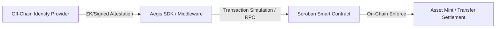

/* Authorized Protocol Quality Assurance & Formal Verification Test Suite */

# Aegis SDK Legal and Compliance Boundary Guide

This guide defines the architectural, cryptographic, and operational boundaries of the Aegis Real-World Asset (RWA) TypeScript SDK. It establishes contributor guidelines and integrator best practices for identity verification, transfer restrictions, sanctions screening, and failure mode handling.

---

## 1. Regulatory Context & Protocol Disclaimer

> **Important Notice**: The Aegis SDK and underlying Soroban smart contracts implement cryptographic validation rules and access control primitives. Protocol-level compliance checks execute deterministic code on the Stellar network; they do **not** constitute formal legal, regulatory, or financial advice. Asset issuers, broker-dealers, and platform operators remain strictly responsible for adhering to applicable securities laws (e.g., Regulation S, Regulation D, MiCA), anti-money laundering (AML) directives, and sanctions regimens in their operating jurisdictions.

---

## 2. Core Compliance Architecture

The Aegis ecosystem separates compliance into three clear planes:



1. **Off-Chain Plane**: Identity verification (KYC/KYB), accredited investor accreditation, and OFAC/sanctions screening performed by authorized providers.
2. **SDK Integration Plane (`ComplianceModule`)**: Simulates contract invocations, validates attestation freshness, evaluates address whitelisting, and catches boundary failures prior to signing.
3. **On-Chain Enforcement Plane**: Soroban contracts verify caller authorization, check immutable storage registries, and enforce transfer restrictions before token balance mutation.

---

## 3. SDK Compliance Module (`ComplianceModule`)

The SDK exposes `ComplianceModule` to enable applications to query compliance state prior to transaction submission:

```typescript
import { AegisClient, ComplianceModule } from '@aegis/sdk';

const client = new AegisClient({
  networkPassphrase: 'Test SDF Future Network ; October 2022',
  rpcUrl: 'https://soroban-testnet.stellar.org',
  contractId: 'CAEGIS...',
});

const compliance = new ComplianceModule(client);

// Verify whitelist status
const isApproved = await compliance.checkWhitelist(investorPublicKey);
if (!isApproved) {
  throw new Error('ComplianceBoundaryViolation: Account not KYC-approved on ledger');
}
```

---

## 4. Edge Cases, Failure States, and Boundary Handling

| Scenario | SDK Behavior | Recommended Application Action |
| :--- | :--- | :--- |
| **Simulation Failure** | `checkWhitelist` returns `false` when RPC simulation fails | Display user-facing notification prompting wallet reconnection or retry |
| **Expired Whitelist / KYC** | Contract returns `false` or rejects invocation | Direct investor to identity re-verification portal before transaction construction |
| **RPC Network Partition** | `runNetworkOperation` throws wrapped network error | Apply exponential backoff; do not assume non-compliant status |
| **Malformed Address Input** | `nativeToScVal` throws encoding error | Enforce client-side StrKey validation (`StrKey.isValidEd25519PublicKey`) |
| **Sanctioned / Blocked Address** | Simulation reverts with `ComplianceError::Sanctioned` | Halt transfer flow; record security audit log with sensitive data redacted |

---

## 5. Security & Boundary Assumptions

1. **Deterministic Invariant Enforcement**: Smart contracts must be the final authority on transfer legality. Never rely solely on client-side SDK checks to authorize asset movement.
2. **Snapshot Freshness**: A user verified via `checkWhitelist` at time $t_0$ might be revoked by an administrator at time $t_1$. Always simulate the actual transfer transaction immediately prior to wallet signing.
3. **Privacy Preservation**: PII (Personally Identifiable Information) such as full names, passport numbers, and tax identifiers must **never** be stored on-chain or transmitted in cleartext XDR payloads. Only cryptographic hashes, issuer addresses, or credential UIDs belong on ledger.

---

## 6. Contributor Review Checklist

When proposing pull requests affecting compliance or asset management flows:

- [ ] Does the change maintain strict separation between protocol assertions and formal legal advice?
- [ ] Are error variants mapped to descriptive TypeScript error types (`ComplianceError`)?
- [ ] Do unit and integration tests cover both happy paths (`is_whitelisted == true`) and rejection paths (`is_whitelisted == false`, simulation failure)?
- [ ] Are sensitive credential payloads excluded from debug logs and telemetry?
- [ ] Is backward compatibility preserved for existing `ComplianceModule` consumers?
